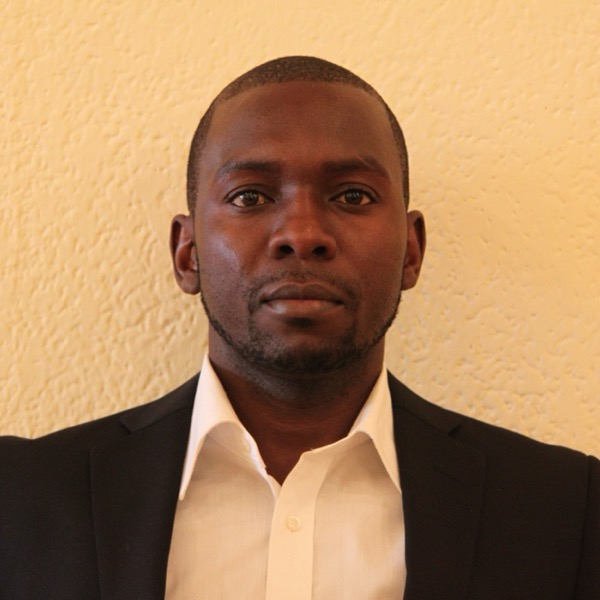

::: {.hero}
{.hero-logo fig-alt="Course logo"}

A practical course on handling data that is too big or too difficult for your usual tools:
parallel processing, collecting data at scale from the web, distributed storage with Hadoop, and
distributed processing and machine learning with Apache Spark, all in Python.

[Start with the syllabus](syllabus.qmd){.btn .btn-primary}
[Set up your computer](guides/software-setup.qmd){.btn .btn-outline-primary}
:::

::: {.stats-strip}
::: {.stat}
[8]{.stat-num} [modules]{.stat-label}
:::
::: {.stat}
[11]{.stat-num} [hands-on notebooks]{.stat-label}
:::
::: {.stat}
[2018]{.stat-num} [taught since]{.stat-label}
:::
::: {.stat}
[EN · FR]{.stat-num} [slides]{.stat-label}
:::
:::

## Who it's for

::: {.audience-grid}
::: {.audience-card}
### Public servants
Economists, statisticians and data scientists in national statistics offices, planning ministries
and other government agencies, often working mainly in SPSS or Stata, who need to handle large
datasets such as census microdata, administrative records and mobile phone data in Python.
:::

::: {.audience-card}
### Data scientists and analysts
People comfortable with Python and pandas on small to medium datasets who want to learn what
changes when the data no longer fits in memory or on a single machine.
:::
:::

::: {.callout-note}
## What this course is, and isn't
This is **not** a course on how to do data analysis. We assume you already know how to clean,
explore and model data. The course teaches the **techniques and tools for large and difficult
datasets**.
:::

## Modules

Each module page has the lecture slides (English and
[French](https://worldbankgroup.sharepoint.com/:f:/r/teams/DECGlobal-WBGroup/Shared%20Documents/General/Exchange/1.%20Courses/1.3%20-%20on-site%20Learning%20Courses/FY2027%20Courses/ENSEA%20FY27%20Courses/Course%20n.%202%20-%20Big%20Data%20Analytics/Translated%20versions?csf=1&web=1))
and notebooks you can read here, open in Google Colab, or download.

::: {.module-list}
::: {.module-row .coming-soon}
[0]{.module-num} [Introduction to Python](notebooks/00-intro-to-python/index.qmd) [Core Python and pandas refresher · *coming soon*]{.module-desc}
:::
::: {.module-row}
[1]{.module-num} [Big Data Basics](notebooks/01-big-data-basics/index.qmd) [What makes data "big", and the technology landscape]{.module-desc}
:::
::: {.module-row}
[2]{.module-num} [Functional Programming & Parallelism](notebooks/02-functional-programming/index.qmd) [Functional Python and `multiprocessing`]{.module-desc}
:::
::: {.module-row}
[3]{.module-num} [Data from the Web](notebooks/03-data-from-the-web/index.qmd) [Web APIs and web scraping]{.module-desc}
:::
::: {.module-row}
[4]{.module-num} [The Hadoop Ecosystem](notebooks/04-hadoop-ecosystem/index.qmd) [HDFS, YARN and MapReduce on a Hadoop sandbox]{.module-desc}
:::
::: {.module-row}
[5]{.module-num} [Introduction to Apache Spark](notebooks/05-intro-to-spark/index.qmd) [First Spark application; RDD and DataFrame APIs]{.module-desc}
:::
::: {.module-row}
[6]{.module-num} [Spark Structured APIs](notebooks/06-spark-structured-apis/index.qmd) [Data wrangling with Spark DataFrames]{.module-desc}
:::
::: {.module-row}
[7]{.module-num} [Machine Learning with Spark](notebooks/07-ml-with-spark/index.qmd) [Model training at scale with Spark MLlib]{.module-desc}
:::
:::

## Where the course has been taught {#past-iterations}

::: {.timeline}
::: {.timeline-item}
[2021–2024]{.timeline-year}
**AIMS Rwanda**: MSc in Mathematical Sciences (Data Science stream). Also at **AIMS Cameroon** in 2023.
:::
::: {.timeline-item}
[2019–2020]{.timeline-year}
**AIMS Rwanda and AIMS Senegal**: [Big Data for Development (BD4D) training programme](https://aims.ac.rw/application/big-data-for-development/)
:::
::: {.timeline-item}
[2019]{.timeline-year}
**[UN Statistical Institute for Asia and the Pacific (SIAP)](https://www.unsiap.or.jp/index.html)**, Chiba, Japan, with JICA: [Second Group Training Programme on Theory and Practices in Official Statistics for Monitoring the SDGs](https://www.unsiap.or.jp/event/2019-08-19.html)
:::
::: {.timeline-item}
[2018]{.timeline-year}
**[SIAP](https://www.unsiap.or.jp/index.html)**, Chiba, Japan, with JICA: [Theory and Practices in Official Statistics for Monitoring the SDGs](https://www.unsiap.or.jp/event/2018-08-27.html)
:::
:::

::: {.instructor-strip}
{.instructor-photo fig-alt="Dr. Dunstan Matekenya"}
Taught by **Dr. Dunstan Matekenya**, Data Scientist at the World Bank Group. [About the instructor →](about.qmd)
:::